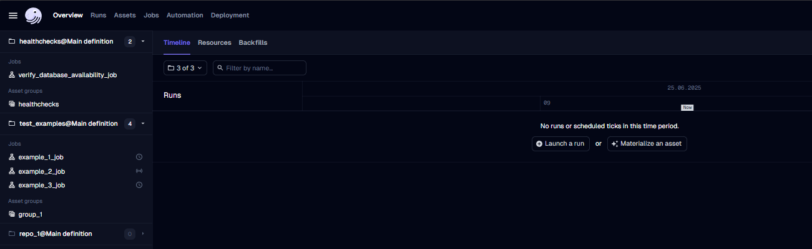

# Modern Data Platform on Dagster & dbt
 
## 📖 Description
 
This project is a data platform. Dagster handles orchestration — it starts, schedules, and watches the jobs. dbt handles the data transformation — it turns raw data into clean, usable tables.
 
The project includes:

- **Dagster** orchestrates the pipeline. It starts jobs, runs them on a schedule, and watches that everything finishes correctly.
- **dbt** transforms the raw data. It turns it into clean, ready-to-use tables.
- **Job steps** run in two ways: on **Celery** workers (RabbitMQ broker, Redis result backend) in Docker Compose, or in a separate **Kubernetes pod for each run** (K8sRunLauncher) in Kubernetes.
- **PostgreSQL** stores the processed data for analytics (an external service).
- **Vault** stores secrets in the Kubernetes setup. Docker Compose reads them from the `.env` file.
- **Python libraries** for data processing.

## 🗂 Project structure

Dagster code is split by business domain, not by object type.

```
app/dagster_easy/
├── shared/                          # code used by several locations
└── code_locations/
    └── main/                        # code location
        ├── definitions.py           # gRPC entry point, imports the repositories
        └── domains/
            ├── healthcheck/         # domain = one Dagster repository
            │   ├── definitions.py
            │   └── verify_database_availability/
            │       └── job.py
            └── marketplace/         # example of a domain with a bigger job
                ├── definitions.py
                └── api_amazon_orders/   # one job
                    ├── source.py
                    ├── transforms.py
                    ├── expectations.py
                    └── job.py
```

**Levels:**

- **Code location** is a unit of deployment: its own gRPC server and, if needed, its own image. Its `definitions.py` only imports repositories.
- **Domain** is a business area, for example `marketplace` or `finance`. It is one Dagster repository. Its `definitions.py` registers assets, checks, jobs, schedules, sensors and the resources the domain needs.
- **Job** is one Dagster job. It always has its own folder, named after the job.

**Files of a job folder:**

- `job.py` is required. It holds the assets or ops and the job, and connects the steps. In a simple job, all the code stays here.
- `source.py` gets the data.
- `transforms.py` holds pure data transformations.
- `expectations.py` holds data quality rules.

Add the optional files only when they are needed. Do not create empty files. Business logic in these files does not depend on Dagster, so it can be tested on its own.

**Rules:**

- A domain does not import another domain. Shared code goes to `shared/`.
- A code location does not import another code location.
- Asset keys must be unique across domains.
- Schedules and sensors of a domain stay in that domain. A sensor that spans several domains goes to a separate domain.
- The `ai_video` location is not split into domains yet, because its domains are not clear.

**To add a job:** create a folder in the domain, write `job.py`, and register it in the `definitions.py` of the domain.

**To add a domain:** create a folder in `domains/`, add `definitions.py`, and import the repository in the `definitions.py` of the location.

**Naming:** see [Naming conventions](./docs/naming.md).

## ⚙️ Installation
 
**Requirements:**

- Love of data engineering ❤️
- Docker and Docker Compose
- For Kubernetes: kind, kubectl, helm (see the K8s guide)

**Get the code:**

```bash
git clone https://github.com/VadimVG/dagster-dbt-docker.git
cd dagster-dbt-docker
```

The data warehouse (DWH) is not part of this project. It runs as a separate Docker Compose project, which creates the Docker network `data-platform-net`. If you run without that project, create the network by hand once:

```bash
docker network create data-platform-net
```

The Kubernetes setup also needs the network `secrets-net` from the Vault project.

**Choose how to run it:**

- [Docker Compose](./ci/docker/README.md)
- [Kubernetes (kind)](./ci/k8s/README.md)
 

## 🚀 Launch and testing
 
1. Open http://localhost:3000/overview/activity/timeline. You should see the Dagster start page. In Kubernetes, start the port-forward first (see the K8s guide, Step 8).

   
 
2. Run the test jobs to check that everything works. Open the sidebar, select a job, and:
   - `verify_database_availability` → click **Materialize all**. Run it first: it creates the schemas in the DWH.
   - `asset_example` → click **Materialize all**.
   - `op_example` → click **Launchpad** → click **Launch run**.
   - `dynamic_output_op_example` → click **Launchpad** → click **Launch run**.
3. If all jobs finish without errors, the project is ready to use.

**Enjoy the beautiful Dagster and dbt 🎉✨**

